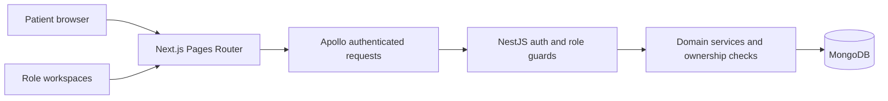

# MN Hospital portfolio walkthrough

A multilingual hospital booking application using Next.js Pages Router, React, TypeScript, Apollo GraphQL, NestJS and MongoDB. The existing clinical design and role boundaries are retained.

## Demonstration
1. Switch EN/KR/UZ and light/dark; compare service and doctor directories.
2. Filter services and paginate doctors. Open a profile and use its appointment link.
3. Select a service, available date and time. Show clinic time zone, break/room checks and price review. Use payment sandbox only.
4. Reload while signed in; log out and demonstrate that appointment selection clears.
5. Show patient, doctor, receptionist and admin workspaces with test accounts. Use synthetic data and redact personal details.
6. Read the visit guide and demonstrate authenticated private messaging from a doctor profile.

## Architecture and evidence

| Capability | Evidence to show |
| --- | --- |
| Sessions | `scripts/verify-auth-session.cjs`, `docs/AUTH_SESSIONS.md`, role-isolated refresh and logout |
| Booking | `verify-booking-submit.cjs`, `verify-booking-draft-reset.cjs`, service calendar and room validation |
| Public content | Live GraphQL catalog, service price/discount logic, real doctor pagination |
| Theme/localization | `verify-dark-contrast.cjs`, EN/KR/UZ dictionaries, visit guide |
| Deployment | Docker standalone image, CI quality gates, commit-aware health endpoint, TLS proxy configuration |

## Limits to state honestly
The deployed HTTP IP still requires a configured HTTPS domain for durable refresh sessions. The AI provider and payment production activation must be verified separately. Do not claim medical accreditation, insurance acceptance, accessibility certification or complete production readiness based on UI screenshots. The public clinic address and legal/privacy/refund text require verification by the clinic before a commercial launch. Avoid invented patient testimonials or treatment claims in the portfolio presentation.

## Korean presentation
프로젝트 소개: 다국어 병원 예약 및 역할별 업무 관리 시스템입니다. 예약 가능 시간, 진료실 배정, 점심시간, 결제 상태와 인증 세션을 기존 업무 규칙에 따라 처리합니다. 프론트엔드 디자인 개선과 백엔드 권한 검증을 구분해 시연하고, 운영 환경의 HTTPS 및 결제 연동 검증 상태를 명확히 설명합니다.
